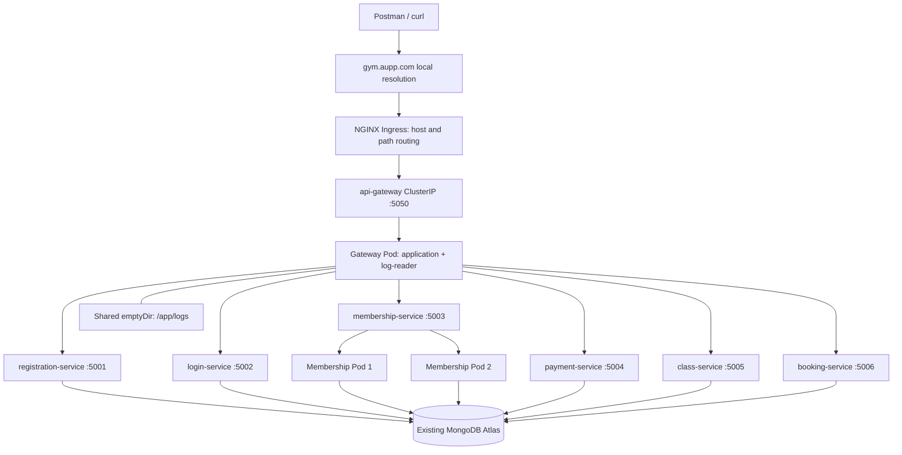

# CLD 376 — Gym Management Kubernetes Final Project

**Archive cleanup (2026-11-18):** The optional exported OCI and Ubuntu Docker archives were removed after verifying all seven images in Docker Desktop and Minikube. Docker retains both AMD64 and ARM64 variants. The archive paths below describe outputs you can regenerate when needed; deployment does not require keeping them. Existing Docker Hub references and all rebuild/export scripts remain intact. The updated local `gym/*:k8s-v1` tags have not been published to Docker Hub. See [the verification record](./KUBERNETES-VERIFICATION.md) for the deletion inventory and recovered space.

## 1. Overview and scope

This is the existing AUPP CLD 376 Node/Express/Mongoose backend moved to a local Minikube cluster on macOS. MongoDB Atlas remains the database. No MongoDB container, database migration, frontend, Helm chart, or EC2 replacement is introduced. Original Compose and EC2 deployment files remain intact.

For observed execution results, see [KUBERNETES-VERIFICATION.md](./KUBERNETES-VERIFICATION.md). Commands and expected responses in this guide are instructions, not claims of successful execution.

## 2. Requirements and architecture

| Requirement | Implementation |
| --- | --- |
| Declarative YAML | [base manifests](./k8s/base/) assembled by plain Kustomize; Secret supplied separately |
| Seven microservices, eight application Pods | Seven Deployments; membership `replicas: 2` |
| Central gateway | Every Ingress path targets `api-gateway:5050`; all seven application Services are ClusterIP |
| Existing cloud database | Per-service existing Atlas URI from Secret; shared JWT secret |
| Fanout routing and domain | NGINX host `gym.aupp.com`, eight Prefix paths, all through gateway |
| Shared volume | Gateway writer and read-only log-reader share `emptyDir` |
| Mac and ARM64 | Build all seven local images inside native Minikube; no Docker Hub push |
| Probes and resource controls | HTTP startup/liveness at verified `/`; database-aware readiness at `/readyz` |



The request sequence is client → NGINX → gateway → Kubernetes service DNS → backend Pod → Atlas. Kubernetes Services distribute connections to ready endpoints. The gateway's previous EC2 round-robin list is replaced in the new ConfigMap with one membership Service URL. Existing EC2 code paths remain usable.

ClusterIP prevents public exposure but is not an authorization boundary against other Pods or a cluster administrator. This lab does not install NetworkPolicies. Client access must use Ingress; do not port-forward any backend. NetworkPolicy enforcement is a future improvement requiring a compatible CNI.

## 3. Repository audit and exact changes

Each service contains `server.js` (dotenv, startup, shutdown), `app.js` (Express, routes, root liveness, 404), `routes/`, `controllers/`, `package.json` and lockfile, `Dockerfile`, and `.dockerignore`. Database services additionally have `config/db.js` and `models/`; membership/payment/class/booking have JWT middleware. The gateway has `config/services.js` and `routes/proxyRoutes.js` instead of database models.

- Database services await `mongoose.connect(process.env.MONGO_URI)` before listening; SIGTERM closes HTTP and Mongoose. Existing `/` JSON root routes work as process liveness endpoints but do not detect a later database disconnection.
- Six backend `app.js` files add only `GET /readyz`, returning `{ "ready": true }` with 200 when Mongoose `readyState === 1`, otherwise 503. Liveness remains independent of Atlas to avoid restart storms on a transient database outage. These internal readiness routes are not proxied by the gateway.
- Gateway `app.js` installs optional [access logging middleware](./api-gateway/middleware/accessLog.js). It activates only with `ACCESS_LOG_FILE`. It logs time, method, known route prefix, status and duration, excluding query strings, identifiers, headers, tokens and request bodies. Logs rotate at approximately 5 MiB into one retained `.1` file. A bounded queue drops records under extreme storage backpressure; this is demo logging, not an audit ledger.
- Gateway proxy behavior is preserved: bodies stream directly without a body parser; Express-stripped mount prefixes are restored; multiple membership targets use round-robin per mounted proxy. K8s sets `MEMBERSHIP_SERVICES=http://membership-service:5003` and `MEMBERSHIP_SERVICE` consistently, so neither EC2 IPs nor the old membership Nginx container is required.
- `/server` already returns `{ "message": "Membership Service is running", "server": SERVER_NAME }` and requires a JWT. Membership YAML injects Pod name as `SERVER_NAME` using the Downward API. No controller change is needed.
- Login signs `{userId, email, role}` for one hour. Membership/payment read operations enforce owner or admin; creation and updates require admin. Class listing requires JWT, mutation requires admin. Booking creation requires member; list/cancel enforces owner or admin. These rules and all schemas remain unchanged.
- Registration hashes passwords with bcrypt and accepts caller-supplied `role`. Public admin registration is an existing vulnerability, retained for compatibility with the coursework demo. Recommended future fix: force public registrations to `member` and provision admins through a trusted separate operation. Do not use this lab as a public production service.
- Dockerfiles use non-root `node`, production `npm ci --omit=dev`, and exclude `.env` and `node_modules`. Gateway/booking use Node 22 Alpine; the other five use Node 20 Alpine. Mongoose requires Node >=20.19 and gateway proxy requires recent Node 22; pull current images when rebuilding. Moving all services to a maintained, pinned LTS image is future work, not a silent runtime migration here.
- `.gitignore` now excludes local Kubernetes secrets and `.env.*`; root README links this guide. No Compose/EC2 file, JWT permission rule, business route, schema, or existing database record is changed by implementation.

### Images and service names

Deployment, Service, Pod `app` label and primary container names match the first column. Every application Service is ClusterIP with the listed port and named `http` targetPort.

| Name | Port | Existing Docker Hub image | Observed registry platforms | New local image |
| --- | ---: | --- | --- | --- |
| api-gateway | 5050 | draven168/gym-api-gateway:v3 | amd64, arm64 | gym/api-gateway:k8s-v1 |
| registration-service | 5001 | draven168/gym-registration:v1 | amd64 only | gym/registration-service:k8s-v1 |
| login-service | 5002 | draven168/gym-login:v1 | amd64 only | gym/login-service:k8s-v1 |
| membership-service | 5003 | draven168/gym-membership:v1 | amd64 only | gym/membership-service:k8s-v1 |
| payment-service | 5004 | draven168/gym-payment:v1 | amd64 only | gym/payment-service:k8s-v1 |
| class-service | 5005 | draven168/gym-class:v1 | amd64 only | gym/class-service:k8s-v1 |
| booking-service | 5006 | draven168/gym-booking:v2 | amd64, arm64 | gym/booking-service:k8s-v1 |

Inspected on 2026-11-18 using `bash scripts/inspect-image-platforms.sh`. `unknown/unknown` attestations are not executable platforms. BusyBox 1.37 supports ARM64 and AMD64. Build every service locally so readiness and logging changes are included, even if its old image supports ARM64. Tags can change; repeat inspection before a later demo.

## 4. YAML layout and settings

- [k8s/base/00-namespace.yaml](./k8s/base/00-namespace.yaml): `gym-management` namespace.
- [k8s/base/01-config.yaml](./k8s/base/01-config.yaml): production setting and service DNS URLs, no credentials.
- `k8s/base/deployment-*.yaml`: seven Deployments, membership replicas 2, others 1. Eight steady-state application Pods, nine containers including sidecar; controller/system Pods are additional.
- `k8s/base/service-*.yaml`: seven ClusterIP Services; no hostPort, NodePort or LoadBalancer for application services.
- [k8s/base/ingress.yaml](./k8s/base/ingress.yaml): NGINX IngressClass, host and eight paths.
- [k8s/base/kustomization.yaml](./k8s/base/kustomization.yaml): explicit manifest inventory, no templates or generated Secrets.
- [k8s/templates/secret.example.yaml](./k8s/templates/secret.example.yaml): placeholders only; never apply directly.
- `k8s/local/secret.yaml`: ignored, private local deployment Secret, excluded from Kustomize.

Apps request 100m CPU/128Mi each and limit 500m/256Mi. Sidecar requests 10m/16Mi, limits 100m/32Mi. Total steady-state application requests: 810m CPU and 1040Mi RAM. Leave room for Kubernetes, ingress and image builds. Rollouts permit one extra Pod and zero unavailable per Deployment; full eight-Pod count applies after rollout completes. RestartPolicy defaults to Always; startup probes allow approximately five minutes. Security: UID/GID/fsGroup 1000, read-only root filesystem, drop all capabilities, no privilege escalation or service account token, RuntimeDefault seccomp. Shared logs are the gateway's writable mount.

## 5. Fresh Mac setup and deployment

Run from the repository root. Install Homebrew first from its official website if unavailable. If tools are missing:

```bash
xcode-select --install
brew install --cask docker
brew install minikube kubectl node
open -a Docker
```

Complete Docker Desktop's first-run UI and wait until `docker info` succeeds. Existing installation observed here: macOS ARM64, Docker Desktop 4.69, Docker Engine 29.4, Minikube 1.39, kubectl 1.34.1. Use a separate profile so the old `minikube` profile is preserved.

Recommended: allocate at least 8 GiB and 4 CPUs to Docker Desktop, then start Minikube with 6 GiB/4 CPUs. This Mac initially exposes only about 4 GiB to Docker; the fallback below uses 3 GiB/2 CPUs and may build more slowly.

```bash
uname -m
docker info
minikube start -p gym-final --driver=docker --cpus=2 --memory=3072 --kubernetes-version=v1.34.1
kubectl config use-context gym-final
minikube -p gym-final status
kubectl --context gym-final get nodes -o wide
minikube -p gym-final addons enable ingress
kubectl --context gym-final -n ingress-nginx rollout status deployment/ingress-nginx-controller --timeout=300s
bash scripts/build-minikube-images.sh
```

For more Docker memory, use `--cpus=4 --memory=6144` on initial creation instead. The image script uses `minikube image build` for all seven existing Dockerfiles directly in the profile; local image tags match YAML and `imagePullPolicy: Never` guarantees no accidental registry fallback. On this ARM64 host these builds produce Linux ARM64 images. Intel Macs build Linux AMD64. No push or emulation is needed. `MINIKUBE_PROFILE` can override the script profile; manifests still use the same namespace.

If dependencies are not installed locally, the Secret helper and local tests require `npm ci` in each service directory. This is not needed for Docker builds, which install their own dependencies. Run:

```bash
for service in api-gateway registration-service login-service membership-service payment-service class-service booking-service; do
  (cd "$service" && npm ci)
done
node --test scripts/test-kubernetes-local.cjs
```

### Atlas credentials and Secret

Keep every existing service's database name and URI. Registration/login must point to the same users collection. All five JWT-consuming services must share the login JWT secret. The Secret has six URI keys so existing database separation is retained rather than forcing all services to a guessed database.

When the existing service `.env` files are available, this helper validates presence and JWT consistency, writes mode 0600, refuses overwrites, and prints no values:

```bash
node scripts/prepare-k8s-secret.cjs
git check-ignore k8s/local/secret.yaml
```

Alternatively:

```bash
mkdir -p k8s/local
cp k8s/templates/secret.example.yaml k8s/local/secret.yaml
chmod 600 k8s/local/secret.yaml
```

Edit the local file privately with each existing `MONGO_URI` and the existing shared `JWT_SECRET`. Quote YAML strings. Do not put credentials in commands, screenshots, report files or source control. Kubernetes Secrets are not inherently encrypted merely because they are base64 encoded; local file permissions and cluster access remain important. Never run `kubectl get secret -o yaml` for screenshots.

Atlas needs its existing database user and an IP access-list entry for the Mac's **outbound public IP** (or VPN/NAT egress), not the Minikube private IP. Add only the necessary egress IP in Atlas if absent. Do not replace the database, delete records, or open access to `0.0.0.0/0`. Pod egress must permit DNS (including SRV/TXT for `mongodb+srv`) and Atlas TLS connections. Keep credentials out of diagnostic output.

```bash
kubectl --context gym-final apply -f k8s/base/00-namespace.yaml
kubectl --context gym-final apply -f k8s/local/secret.yaml
kubectl --context gym-final apply --dry-run=server -k k8s/base
kubectl --context gym-final apply -k k8s/base
kubectl --context gym-final -n gym-management rollout status deployment --timeout=300s
kubectl --context gym-final -n gym-management get deployments,pods,services,ingress -o wide
```

After ConfigMap/Secret changes, restart affected Deployments because environment variables are read at startup. After rebuilding an unchanged local tag, restart Deployments to pick up the new images:

```bash
kubectl --context gym-final -n gym-management rollout restart deployment
kubectl --context gym-final -n gym-management rollout status deployment --timeout=300s
```

## 6. NGINX, local resolution and Fanout DNS

The course asks for NGINX; Minikube's ingress addon supplies the community ingress-nginx controller. As of this project's November 2026 execution, that controller has retired: see [the Kubernetes announcement](https://kubernetes.io/blog/2025/11/11/ingress-nginx-retirement/). Keep this isolated local lab; plan a maintained controller or Gateway API for production. The Ingress API itself is not retired. Minikube documents Docker-driver networking caveats, so verify addon rollout rather than assuming support from enabling it: [Docker driver](https://minikube.sigs.k8s.io/docs/drivers/docker/).

The Ingress routes `/register`, `/login`, `/memberships`, `/payments`, `/classes`, `/bookings`, `/server` and `/` using `pathType: Prefix`. Kubernetes chooses the longest matching path; `/` is a fallback. Every backend target is the gateway, with no rewrite annotation, so business paths and query strings arrive intact. A different Host header should not reach this application's host rule.

DNS only resolves a host to an address; it does not route URL paths. The term "Fanout DNS" in the course is demonstrated by the local name plus NGINX host/path fanout rules; the centralized gateway performs actual service fanout. This is intentionally different from a typical Ingress diagram that routes paths directly to backend services.

### Reliable Docker-driver demo route

macOS may not reach `minikube ip` directly because Docker's Linux network lives inside a VM. Forward the **Ingress controller**, keeping it in the request path (not the gateway or a backend). Leave this terminal running:

```bash
kubectl --context gym-final -n ingress-nginx port-forward service/ingress-nginx-controller 8080:80 --address=127.0.0.1
```

In another terminal:

```bash
curl -i -H 'Host: gym.aupp.com' http://127.0.0.1:8080/
curl -i --resolve gym.aupp.com:8080:127.0.0.1 http://gym.aupp.com:8080/
curl -i -H 'Host: unrelated.invalid' http://127.0.0.1:8080/
```

For Postman, manually add `127.0.0.1 gym.aupp.com` using `sudo nano /etc/hosts`, then:

```bash
sudo dscacheutil -flushcache
sudo killall -HUP mDNSResponder
dscacheutil -q host -a name gym.aupp.com
curl -i http://gym.aupp.com:8080/
```

Postman base URL: `http://gym.aupp.com:8080`. Without the hosts entry, use `http://127.0.0.1:8080` with a manual `Host: gym.aupp.com` header. Disable a Postman proxy for local addresses if it intercepts requests. Do not use HTTPS until TLS is configured.

`/etc/hosts` is a local name override, not a real DNS record; `dig`/`nslookup` usually bypass it, so they cannot prove that override works. `curl --resolve` is a curl-only override and does not configure Postman or the system. We do not own `aupp.com` and are not publishing a DNS change. Real DNS would need permission to create a record pointing at an externally reachable ingress address. Use `gym.test` instead if desired by changing both Ingress YAML host and local resolution consistently.

If direct node access is supported by a different driver, test `curl -H 'Host: gym.aupp.com' "http://$(minikube -p gym-final ip)/"` and map the host to that reachable IP instead. A `minikube tunnel` terminal may work with supported configurations, but do not assume it makes the controller reachable at localhost; inspect the actual address. The controller port-forward is the reproducible choice for this Docker-driver Mac.

## 7. Shared log volume proof

The API gateway creates `/app/logs/access.log` and records real completed HTTP requests, including probes. The `log-reader` waits until the file exists and runs BusyBox `tail -n +1 -F`; `-F` follows rotation. Both containers use the same Pod-scoped `access-logs` emptyDir. fsGroup 1000 permits the non-root writer; sidecar mounts read-only. The 100Mi volume limit and two approximately 5Mi files bound normal disk usage.

```bash
curl -H 'Host: gym.aupp.com' http://127.0.0.1:8080/server
kubectl --context gym-final -n gym-management exec deployment/api-gateway -c api-gateway -- tail -n 10 /app/logs/access.log
kubectl --context gym-final -n gym-management exec deployment/api-gateway -c log-reader -- tail -n 10 /app/logs/access.log
kubectl --context gym-final -n gym-management logs deployment/api-gateway -c log-reader --tail=20
kubectl --context gym-final -n gym-management describe deployment api-gateway
```

The unauthenticated `/server` call intentionally logs 401. Look for the matching timestamp/route/status in both reads and sidecar stdout. Requests made during Pod replacement may use a different Pod; capture evidence after rollout settles. emptyDir survives a container restart within the same Pod, but is deleted when the Pod is replaced or removed. Atlas data is independent and remains in the cloud. No PVC is included: persistent local logs are optional, and an RWO PVC would complicate simultaneous gateway rollout Pods. A future PVC needs an explicit storage class, retention policy and rollout strategy; do not claim emptyDir is persistent storage.

## 8. Postman API verification in order

Set collection variable `baseUrl` to `http://gym.aupp.com:8080` after the hosts mapping (or loopback with Host header). Use `Content-Type: application/json` for JSON. Use unique **demo** users and records in the existing Atlas database; these tests create records and should not overwrite existing real data. Never paste passwords/JWTs into the report. Environment variables for tokens should be local/sensitive in Postman.

1. `GET {{baseUrl}}/`: 200 gateway JSON `message`.
2. `POST /register`, body `{"name":"Demo Admin","email":"<unique-admin-email>","password":"<private-demo-password>","role":"admin"}`: 201, `{message,user:{id,name,email,role}}`. Existing public admin creation is only retained for this lab; prefer an existing demo admin. Duplicate email returns 409.
3. `POST /register`, same shape with a unique member email and `role: "member"`: 201. Save `user.id` as `memberId`.
4. `POST /login` for each account with `{email,password}`: 200, `{message,token,user:{id,name,email,role}}`. Save `adminToken`/`memberToken`. Tokens expire after one hour. Do not use a user ID from a different account for the member flow.

Set Bearer token as indicated below. Replace ID variables with IDs from the **current** create response, never guessed values.

| Method and path | Token | JSON body | Expected response |
| --- | --- | --- | --- |
| POST /memberships | Admin | `{"userId":"{{memberId}}","plan":"monthly","startDate":"2026-11-18","endDate":"2026-12-18","status":"active"}` | 201 `{message,membership}`; save `membership._id` |
| GET /memberships/{{memberId}} | Member or Admin | — | 200 membership document; 404 if absent |
| PATCH /memberships/{{membershipId}} | Admin | `{"plan":"quarterly"}` | 200 `{message,membership}` |
| POST /payments | Admin | `{"userId":"{{memberId}}","amount":25,"paymentMethod":"cash","status":"paid"}` | 201 `{message,payment}`; save `payment._id` |
| GET /payments/{{memberId}} | Member or Admin | — | 200 array |
| PATCH /payments/{{paymentId}} | Admin | `{"status":"pending"}` | 200 `{message,payment}` |
| POST /classes | Admin | `{"className":"Final Demo Yoga","trainer":"Demo Trainer","schedule":"Friday 18:00","capacity":10,"status":"available"}` | 201 `{message,gymClass}`; save `gymClass._id` |
| GET /classes | Member or Admin | — | 200 array |
| PATCH /classes/{{classId}} | Admin | `{"capacity":12}` | 200 `{message,gymClass}` |
| POST /bookings | Member | `{"classId":"{{classId}}"}` | 201 `{message,booking}`; userId comes from JWT; save `booking._id` |
| GET /bookings/{{memberId}}?page=1&limit=20 | Member or Admin | — | 200 array plus `X-Page`, `X-Page-Size`, `X-Total-Count`, `X-Total-Pages` |
| PATCH /bookings/{{bookingId}}/cancel | Owner or Admin | `{}` | 200 `{message,booking}` with cancelled status |
| GET /server | Any valid JWT | — | 200 `{message,server}` with membership Pod name |

Membership statuses: active/expired/cancelled. Payment methods: cash/card/bank; payment statuses: paid/pending/failed. Class statuses: available/full/cancelled. Booking statuses: booked/cancelled. Booking list defaults 20, maximum 100. Creating a second active booking for the same user/class returns 409; cancelling again returns 409. Admin booking creation returns 403. No capacity or class existence check is implemented; do not infer it from a successful booking. Existing membership read uses `findOne`, so use a fresh demo member to avoid ambiguity from multiple memberships.

Optional Postman Tests snippets for login and create responses:

```javascript
// Login response: use separate variable names for Admin and Member requests.
pm.test('Login succeeded', () => pm.response.to.have.status(200));
pm.environment.set('memberToken', pm.response.json().token);
pm.environment.set('memberId', pm.response.json().user.id);
// Class create response, in that request's Tests tab:
// pm.environment.set('classId', pm.response.json().gymClass._id);
```

### JWT and ownership checks

| Test | Request | Expected |
| --- | --- | --- |
| Wrong password | POST /login with valid demo email and wrong password | 401 `Invalid email or password` |
| Missing JWT | GET /classes without Authorization | 401 `Token required` |
| Invalid JWT | GET /classes with `Bearer invalid` | 401 `Invalid token` |
| Member on admin route | POST /classes with member JWT and valid class body | 403 `Unauthorized: Admin access required` |
| Wrong owner | GET /payments/<another-user-id> with member JWT | 403 `Unauthorized access` |
| Admin creates booking | POST /bookings with admin JWT | 403 `Only members can book gym classes` |

```bash
curl -i -H 'Host: gym.aupp.com' http://127.0.0.1:8080/classes
curl -i -H 'Host: gym.aupp.com' -H 'Authorization: Bearer invalid' http://127.0.0.1:8080/classes
```

Repeat with your own valid tokens in Postman. Avoid putting real tokens into shell history. Tests that create records are intentionally manual; static/local automated tests do not write to Atlas.

## 9. Replicas, Atlas and internal DNS proof

```bash
kubectl --context gym-final -n gym-management get deployment membership-service
kubectl --context gym-final -n gym-management get pods -l app=membership-service -o wide
kubectl --context gym-final -n gym-management get endpointslices -l kubernetes.io/service-name=membership-service -o wide
kubectl --context gym-final -n gym-management exec deployment/api-gateway -c api-gateway -- node -e 'require("node:dns").lookup("membership-service", (e,a)=>{if(e)process.exit(1);console.log(a)})'
```

Use a valid JWT for repeated `/server` requests through Ingress. In Postman, repeat the request using the runner (e.g. 30 iterations), recording distinct `server` values. Kubernetes Service balancing is connection-based and need not alternate. A client `Connection: close` header does not guarantee the gateway opens a fresh upstream connection. If only one Pod appears, first verify both ready EndpointSlice addresses; repeat over time/new connections rather than claiming a failure or strict round-robin. Do not change the gateway to explicit Pod IPs.

For a private shell session, read a token without echoing it, make repeated calls, then clear it:

```bash
# Bash syntax; start bash first if your terminal is zsh.
read -r -s -p 'Demo JWT: ' DEMO_TOKEN
for attempt in {1..30}; do
  curl -sS -H 'Host: gym.aupp.com' -H "Authorization: Bearer $DEMO_TOKEN" http://127.0.0.1:8080/server
  echo
done
unset DEMO_TOKEN
```

Atlas readiness is verified by all six backend `/readyz` probes (connected Mongoose). A private ping command checks the actual database without showing the URI:

```bash
kubectl --context gym-final -n gym-management exec deployment/membership-service -- node -e 'const m=require("mongoose");(async()=>{try{await m.connect(process.env.MONGO_URI,{serverSelectionTimeoutMS:10000});await m.connection.db.command({ping:1});console.log("Atlas ping OK")}catch{console.error("Atlas ping failed");process.exitCode=1}finally{await m.disconnect()}})()'
```

After creating demo records, screenshot only nonsecret fields in the existing Atlas collections (`users`, `memberships`, `payments`, `gymclasses`, `bookings`, subject to existing database configuration). Never show password hashes, connection strings or credentials. Restart one Deployment with `kubectl --context gym-final -n gym-management rollout restart deployment/membership-service`, wait for rollout, then read the same membership through Ingress. The same `_id`/values demonstrate persistence beyond Pod replacement. Do not delete collections or indexes. Existing duplicate active bookings may prevent unique index creation; investigate without deleting data automatically.

## 10. Screenshot commands and evidence

Use the exact report headings in [the screenshot checklist](./FINAL-PROJECT-SCREENSHOT-CHECKLIST.md). Capture actual outputs, record dates and label any failure honestly.

```bash
minikube -p gym-final status
minikube -p gym-final image ls
kubectl --context gym-final -n gym-management get deployments
kubectl --context gym-final -n gym-management get pods -o wide
kubectl --context gym-final -n gym-management get services -o wide
kubectl --context gym-final -n gym-management get ingress -o wide
kubectl --context gym-final -n gym-management describe ingress gym-ingress
kubectl --context gym-final -n gym-management get endpointslices
kubectl --context gym-final -n gym-management get events --sort-by=.lastTimestamp
kubectl kustomize k8s/base
```

Expected after successful rollout: seven Deployments, membership 2/2, others 1/1; eight application Pods, gateway `2/2` containers and each backend `1/1`; seven ClusterIP application Services. No application external IP. Ingress address alone does not prove macOS reachability: include Host-header curl evidence. YAML screenshots must omit the real Secret; show the placeholder template instead. Do not capture resolved Compose configuration because it may contain interpolated secrets.

## 11. Troubleshooting

| Symptom | Resolution |
| --- | --- |
| Docker daemon/socket unavailable | Open Docker Desktop and wait for `docker info` |
| Requested memory exceeds Docker capacity | Increase Docker Desktop memory or use 3072Mi/2 CPU fallback; do not force overcommit |
| `ErrImageNeverPull` | Build the exact tag inside `gym-final`; inspect `minikube -p gym-final image ls` |
| `exec format error` | Rebuild locally for native Linux architecture; old five v1 images are AMD64 only |
| Pods pending | Describe Pod/events for insufficient resources; reduce concurrent rollouts or increase Docker resources |
| Missing Secret/key | Apply ignored local Secret in gym-management and compare key names privately |
| Restarting before listening | Check Atlas IP list, URI/database names, database user and DNS; avoid sharing raw logs containing connection errors |
| Unready after DB interruption | `/readyz` remains 503 until Mongoose reconnects; liveness should not restart the healthy HTTP process |
| 404 from NGINX | Correct Host header, IngressClass nginx and controller rollout; inspect Ingress |
| 502/503 from gateway/ingress | Verify ready EndpointSlices and service ports; check target Pod readiness |
| `minikube ip` unreachable | Use controller port-forward on loopback as documented |
| Port-forward disconnected | Restart it after the selected controller Pod changes |
| `EACCES` on log file | Verify fsGroup 1000 and shared mount; do not run application as root |
| Sidecar quiet | Generate a gateway request, inspect both mounts, allow tail to notice file creation/rotation |
| JWT invalid across services | Ensure all validators use login's secret; restart after secret changes; re-login on token expiration |
| Old code after build | Restart affected Deployment or use a new image tag consistently in YAML and build command |

## 12. Cleanup and redeployment

Stop the controller port-forward with Ctrl-C; stop the cluster with `minikube stop -p gym-final`. This preserves the local profile for another session.

Only when you intentionally want to remove this lab's Kubernetes workloads:

```bash
kubectl --context gym-final delete namespace gym-management
# Reapply namespace, ignored Secret, then base to redeploy.
```

Only when you intentionally want to delete the entire isolated local cluster:

```bash
minikube delete -p gym-final
```

Neither operation deletes Atlas data. Do not run database deletion commands. Keep the ignored Secret privately for redeployment, or remove it manually when no longer needed. Remove only the demo host mapping you added; retain unrelated hosts entries. Fresh deployment repeats Section 5, including rebuilding images if the profile was deleted. Existing EC2 Compose files and the old Minikube profile are independent.

## 13. Limitations and future improvements

This is an HTTP-only local coursework environment. Public admin registration, permissive update payloads, lack of booking capacity validation, record-only payment processing, and existing error logging are inherited behavior. No roles or demo credentials were silently changed. Add trusted admin provisioning, stricter validation, TLS, maintained ingress/controller versions, enforced NetworkPolicies, log shipping, CI scanning and pinned supported Node images before production. Gateway shutdown does not guarantee draining the final queued access-log writes. emptyDir logs are temporary; Atlas persistence is separate. No PVC claim is made. See observed verification status before claiming a working demo.

References: [Kubernetes Ingress](https://kubernetes.io/docs/concepts/services-networking/ingress/), [emptyDir volumes](https://kubernetes.io/docs/concepts/storage/volumes/#emptydir), [Minikube image build](https://minikube.sigs.k8s.io/docs/commands/image/), [Docker driver](https://minikube.sigs.k8s.io/docs/drivers/docker/), [ingress-nginx retirement](https://kubernetes.io/blog/2025/11/11/ingress-nginx-retirement/).

### Optional automated live smoke test

With the controller port-forward running, `node scripts/smoke-ingress.cjs --write-demo-data` runs the same CRUD/authentication sequence through NGINX and the gateway. The explicit flag acknowledges that it adds unique demo Admin/Member accounts and records to the existing Atlas database. It never deletes existing records. Credentials, tokens and demo IDs are stored only in a mode-0600 JSON file under ignored `k8s/local/`, for privately continuing the Postman demo. Console output contains status checks and replica names, not tokens or passwords. Override `GYM_BASE_URL` if the controller uses a different reachable address; Host remains `gym.aupp.com`. A partial failure can leave uniquely named demo records; resolve it without deleting existing data. This script is not a replacement for screenshots or persistence-after-restart verification.

## 14. Portable images for Ubuntu EC2 (AMD64 and Graviton ARM64)

Ubuntu is compatible with these Linux Alpine-based containers; the container userspace does not need to match the Ubuntu host distribution. CPU architecture does matter: ordinary Intel/AMD EC2 instances use `linux/amd64`, while Graviton uses `linux/arm64`. The new portable build covers both and includes the readiness/logging changes.

```bash
bash scripts/build-portable-images.sh
```

This exports seven multi-platform OCI archives under ignored `k8s/local/images/` without pushing or overwriting any existing Docker Hub tags. Docker Desktop provides cross-architecture emulation; AMD64 builds can be slower on Apple Silicon. Each archive contains both architectures. This is separate from the native Minikube image workflow; continue using `build-minikube-images.sh` for the local demo.

On Docker Engine with the containerd image store enabled, load the required platform on Ubuntu, for example:

```bash
uname -m
# x86_64 EC2:
docker load --platform linux/amd64 -i api-gateway-k8s-v1.oci.tar
# aarch64 / Graviton EC2 instead:
docker load --platform linux/arm64 -i api-gateway-k8s-v1.oci.tar
docker image inspect gym/api-gateway:k8s-v1 --format '{{.Os}}/{{.Architecture}}'
```

Use a current Docker version supporting OCI archives and `docker load --platform` (API 1.48+). Older/classic Docker stores may not import these archives. A compatible alternative for older Ubuntu installations is a single-platform Docker archive built with `docker buildx build --platform linux/amd64 -t gym/api-gateway:k8s-v1 --output type=docker,dest=api-gateway-amd64.tar ./api-gateway`, then `docker load -i api-gateway-amd64.tar` on EC2. Repeat for the other services, using ARM64 instead for Graviton.

For later registry deployment, publish a new tag with `docker buildx build --platform linux/amd64,linux/arm64 -t YOUR_REGISTRY/gym-api-gateway:NEW_TAG --push ./api-gateway` only when you intend to publish. No registry push is part of the local workflow. The old EC2 Compose files still reference their original image tags; using the new images on EC2 will require an explicit image override or updated deployment copy later. Do not assume rebuilding local images updates running EC2 containers. Keep the same Atlas URIs and shared JWT secret privately on EC2; Kubernetes-only `ACCESS_LOG_FILE` is optional outside Kubernetes.

Static semantic validation is also available with `ruby --disable-gems scripts/validate-k8s.rb`. It checks all manifests and cross-resource relationships without requiring a cluster. It complements server-side Kubernetes schema validation; it does not prove cluster connectivity.

### Standard Docker archives for older Ubuntu Docker installations

After loading the portable OCI archives into this Mac's Docker engine, `bash scripts/export-ubuntu-images.sh` exports **AMD64 single-platform Docker archives** under `k8s/local/images/ubuntu-amd64/`, plus SHA256SUMS. These are easier to load on classic Ubuntu Docker stores: copy the directory to EC2, verify `sha256sum -c SHA256SUMS`, then `docker load -i api-gateway-k8s-v1.docker.tar` and repeat for the other six files. `EC2_ARCH=arm64 bash scripts/export-ubuntu-images.sh` instead exports Graviton-compatible archives. The export command on the Mac requires Docker API 1.48+; the resulting standard single-platform archives do not require `--platform` when loaded on EC2.

After the automated demo, `node scripts/verify-live-readonly.cjs --replicas` reads its private IDs/token, verifies the saved membership and repeats `/server` with idle gaps. This allows gateway upstream keep-alive connections to expire between attempts; it still does not guarantee alternating responses. Run this before replacing membership Pods when capturing their initial names. After a membership rollout, run `node scripts/verify-live-readonly.cjs` to verify the same membership `_id` and updated plan persist, without creating more records. A valid unexpired demo token and the controller port-forward are required.
