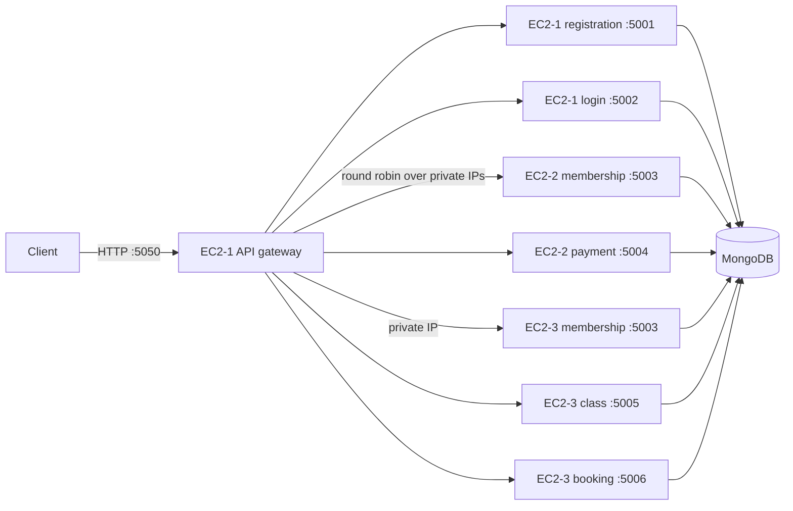

# Gym Management System

A Node.js microservice application for gym registration, authentication, memberships, payments, classes, and class bookings. Services use Express and MongoDB through Mongoose. The API gateway is the public entry point; service-to-service traffic stays on private Docker networks or, in the three-EC2 deployment, travels over EC2 private IPs.

> This repository is currently configured as a sandbox/lab deployment. Review the production considerations near the end before exposing it to real users or processing real payments.

## Contents

- [Services](#services)
- [Architecture](#architecture)
- [API routes](#api-routes)
- [Run everything on one host](#run-everything-on-one-host)
- [Deploy across three EC2 instances](#deploy-across-three-ec2-instances)
- [Build and publish Docker images](#build-and-publish-docker-images)
- [Environment variables and secrets](#environment-variables-and-secrets)
- [Troubleshooting](#troubleshooting)
- [Production considerations](#production-considerations)

## Services

| Service | Port | Responsibility | Main data |
| --- | ---: | --- | --- |
| API gateway | 5050 | Proxies public requests to the internal services; balances membership requests across configured targets | None |
| Registration | 5001 | Creates user accounts and hashes passwords with bcrypt | User: name, email, password hash, role |
| Login | 5002 | Verifies credentials and issues one-hour JWTs | User credentials |
| Membership | 5003 | Creates, reads, and updates memberships; reports which replica answered | Membership: user, plan, dates, status |
| Payment | 5004 | Records and updates payment entries | Payment: user, amount, method, date, status |
| Class | 5005 | Creates, lists, and updates gym classes | Class: name, trainer, schedule, capacity, status |
| Booking | 5006 | Creates, lists, and cancels class bookings | Booking: user, class ID, date, status |
| Nginx | 80 (internal) | Single-host deployment load balancer for the two membership containers | None |

Each service has its own Express application, routes, controller, and (where it stores data) Mongoose model. Each database-backed service connects using its own `MONGO_URI`.

## Architecture

### Three EC2 instances

The current distributed lab layout uses separate Compose projects. Docker Compose networks are local to each host, so cross-instance calls use private IPv4 addresses. Registration and login are placed with the gateway on EC2-1 because they were not assigned to a host in the requested layout.



The membership gateway uses `MEMBERSHIP_SERVICES`, a comma-separated list of target URLs, and selects targets in round-robin order. In the single-host Compose files it uses the legacy `MEMBERSHIP_SERVICE` target, which points to Nginx.

### Compose files

| File | Purpose |
| --- | --- |
| `docker-compose.yml` | Builds and runs the complete stack on one Docker host. It builds from local source and uses the `backend` network; only the gateway publishes a host port. |
| `docker-compose.ec2.yml` | Pull-only, single-host deployment. It uses the current gateway `v3`, booking `v2`, and the other services' `v1` images. |
| `compose.ec2-api.yml` | EC2-1: gateway, registration, and login. Requires private-IP variables in a Compose `.env` file. |
| `compose.ec2-services-2.yml` | EC2-2: membership instance 1 and payment. |
| `compose.ec2-services-3.yml` | EC2-3: membership instance 2, class, and booking. |

For the three-instance procedure and security group rules, see [EC2-THREE-INSTANCE.md](./EC2-THREE-INSTANCE.md). For the one-host setup, see [EC2-DEPLOY.md](./EC2-DEPLOY.md).

## API routes

All API calls go through the gateway. Protected endpoints expect `Authorization: Bearer <JWT>`. Registration and login are public. Role and ownership restrictions are enforced by the respective services.

| Method | Gateway path | Access | Description |
| --- | --- | --- | --- |
| `GET` | `/` | Public | Gateway liveness response |
| `POST` | `/register` | Public | Register an account; body includes `name`, `email`, and `password` |
| `POST` | `/login` | Public | Authenticate with `email` and `password`; returns a JWT |
| `POST` | `/memberships` | Admin | Create a membership |
| `GET` | `/memberships/:userId` | Admin or same user | Read a user's membership |
| `PATCH` | `/memberships/:id` | Admin | Update a membership |
| `GET` | `/server` | Authenticated | Return membership instance name (useful for checking replicas) |
| `POST` | `/payments` | Admin | Record a payment |
| `GET` | `/payments/:userId` | Admin or same user | List payments for a user |
| `PATCH` | `/payments/:id` | Admin | Update a payment |
| `POST` | `/classes` | Admin | Create a class |
| `GET` | `/classes` | Authenticated | List classes |
| `PATCH` | `/classes/:id` | Admin | Update a class |
| `POST` | `/bookings` | Member | Book a class using `classId` |
| `GET` | `/bookings/:userId` | Admin or same user | List a user's bookings; accepts `page` and `limit` |
| `PATCH` | `/bookings/:id/cancel` | Admin or owner | Cancel a booking |

Booking list pagination defaults to 20 records per page and caps `limit` at 100. The response remains an array; pagination details are returned in `X-Page`, `X-Page-Size`, `X-Total-Count`, and `X-Total-Pages` headers.

Example login and authenticated request:

```bash
curl -X POST http://<API-HOST>:5050/login \
  -H 'Content-Type: application/json' \
  -d '{"email":"member@example.com","password":"your-password"}'

curl http://<API-HOST>:5050/classes \
  -H 'Authorization: Bearer <JWT>'
```

## Run everything on one host

Requirements: Docker Engine, the Docker Compose plugin, and the repository source. On Ubuntu, verify Compose with `docker compose version`. If the plugin is not installed, follow Docker's [Ubuntu installation instructions](https://docs.docker.com/engine/install/ubuntu/).

If `sudo apt-get install docker-compose-plugin` says `Unable to locate package`, Docker's official apt repository likely has not been added. On Ubuntu EC2, configure that repository and install the plugin:

```bash
sudo apt-get update
sudo apt-get install -y ca-certificates curl
sudo install -m 0755 -d /etc/apt/keyrings
sudo curl -fsSL https://download.docker.com/linux/ubuntu/gpg -o /etc/apt/keyrings/docker.asc
sudo chmod a+r /etc/apt/keyrings/docker.asc

echo \
  "deb [arch=$(dpkg --print-architecture) signed-by=/etc/apt/keyrings/docker.asc] https://download.docker.com/linux/ubuntu \
  $(. /etc/os-release && echo \"${UBUNTU_CODENAME:-$VERSION_CODENAME}\") stable" | \
  sudo tee /etc/apt/sources.list.d/docker.list > /dev/null

sudo apt-get update
sudo apt-get install -y docker-compose-plugin
docker compose version
```

This installs the Compose v2 plugin used by commands such as `docker compose -f compose.ec2-api.yml pull`. If Docker itself is not installed from Docker's repository, follow the complete official setup instructions linked above. If your account gets a Docker socket permission error, prefix Docker commands with `sudo` (for example, `sudo docker compose ...`).

Create a `.env` file for each database-backed service. At minimum, provide `MONGO_URI`; login, membership, payment, class, and booking also need `JWT_SECRET`. Do not commit these secret files. The root `.gitignore` excludes `.env` files.

From the repository root:

```bash
docker compose config
docker compose up -d --build
docker compose ps
docker compose logs -f api-gateway
```

The gateway is available at `http://localhost:5050/`. Stop the stack with `docker compose down`. This Compose network is single-host only; it does not distribute services across the three EC2 machines.

## Deploy across three EC2 instances

Use the split Compose files rather than `docker-compose.yml` for this layout. Copy the right Compose file and the required service folders (including each service's `.env`) to each host. Put the private IP settings in a Compose `.env` beside `compose.ec2-api.yml` on EC2-1. Replace the sample addresses in [EC2-THREE-INSTANCE.md](./EC2-THREE-INSTANCE.md) with your actual private IPs.

Open only the required security group traffic:

- EC2-1: TCP `5050` from the client IPs that need API access.
- EC2-2: TCP `5003` and `5004` from EC2-1's security group.
- EC2-3: TCP `5003`, `5005`, and `5006` from EC2-1's security group.

Keep service ports off public ingress. Configure the MongoDB network access list to accept the EC2 private addresses. In each instance's deployment directory, run the matching commands:

```bash
# EC2-1
docker compose -f compose.ec2-api.yml pull
docker compose -f compose.ec2-api.yml up -d
docker compose -f compose.ec2-api.yml ps

# EC2-2
docker compose -f compose.ec2-services-2.yml pull
docker compose -f compose.ec2-services-2.yml up -d
docker compose -f compose.ec2-services-2.yml ps

# EC2-3
docker compose -f compose.ec2-services-3.yml pull
docker compose -f compose.ec2-services-3.yml up -d
docker compose -f compose.ec2-services-3.yml ps
```

The public API is `http://<EC2-1-PUBLIC-IP>:5050/`. The private service addresses configured on EC2-1 must be the instances' private IPs, not their public IPs.

If `docker compose` returns an unknown command or flag error, follow the Ubuntu installation steps above and check `docker compose version` before retrying. `docker-compose` (with a hyphen) is the legacy standalone command and is not installed by default.

## Build and publish Docker images

Every service has a Dockerfile based on a Node Alpine image (Nginx uses `nginx:alpine`). The Dockerfiles install production dependencies with `npm ci --omit=dev`, copy service source, and run as the non-root `node` user for Node services. `.dockerignore` excludes `.env`, `node_modules`, and local noise from each build context.

The currently referenced image tags are:

| Service | Docker Hub image |
| --- | --- |
| API gateway | `draven168/gym-api-gateway:v3` |
| Booking | `draven168/gym-booking:v2` |
| Registration | `draven168/gym-registration:v1` |
| Login | `draven168/gym-login:v1` |
| Membership | `draven168/gym-membership:v1` |
| Payment | `draven168/gym-payment:v1` |
| Class | `draven168/gym-class:v1` |
| Nginx | `draven168/gym-nginx:v1` |

Gateway `v3` and booking `v2` were built and pushed as multi-architecture images for `linux/amd64` and `linux/arm64`. To publish an updated gateway or booking image from a machine with Docker Buildx and Docker Hub access, use a new tag:

```bash
docker login
TAG=v4 docker buildx bake -f docker-compose.yml \
  --set '*.platform=linux/amd64,linux/arm64' --push api-gateway
```

For a booking release, use an unused tag such as `TAG=v3` and target `booking-service`. Then update the image tag in the corresponding EC2 Compose file, copy that file to the host, and run `pull` followed by `up -d`. The root `docker-compose.yml` builds from source locally; it does not automatically publish images. For a complete build and push, target each image service in Buildx Bake and use a consistent tag.

## Environment variables and secrets

| Service | Required variables |
| --- | --- |
| Registration | `MONGO_URI` |
| Login | `MONGO_URI`, `JWT_SECRET` |
| Membership (both instances) | `MONGO_URI`, `JWT_SECRET`, optional `SERVER_NAME` |
| Payment | `MONGO_URI`, `JWT_SECRET` |
| Class | `MONGO_URI`, `JWT_SECRET` |
| Booking | `MONGO_URI`, `JWT_SECRET` |
| Gateway, one-host | `REGISTRATION_SERVICE`, `LOGIN_SERVICE`, `MEMBERSHIP_SERVICE`, `PAYMENT_SERVICE`, `CLASS_SERVICE`, `BOOKING_SERVICE` (Compose supplies defaults) |
| Gateway, three-host | `MEMBERSHIP_SERVICES` or the EC2 Compose interpolation variables `MEMBERSHIP_1_PRIVATE_IP`, `MEMBERSHIP_2_PRIVATE_IP`, `PAYMENT_PRIVATE_IP`, `CLASS_PRIVATE_IP`, `BOOKING_PRIVATE_IP` |

Ports can be overridden by Compose `PORT` settings. `GATEWAY_PORT` changes the published host port; the container still listens on 5050. Use the same JWT secret across services that validate the same tokens. Keep MongoDB URIs and JWT secrets in host-side `.env` files, never in images or source control.

## Troubleshooting

| Symptom | Check |
| --- | --- |
| Compose file not found | Run commands from the directory containing the selected Compose file; check with `ls` |
| `docker compose` not recognized | Check `docker compose version`; install the Compose plugin on Ubuntu |
| Service unhealthy or restarting | Run `docker compose -f <file> logs --tail=100 <service>` and check its `.env` values and database reachability |
| Gateway cannot reach an EC2 service | Check EC2-1 private-IP values, host port mappings, and security group inbound rules from EC2-1 |
| API returns 502 or proxy error | Check the target container's `ps` and logs; confirm the target service root is reachable on its private address and port |
| Wrong image architecture | `docker image inspect <image>` or `uname -m`; the current gateway and booking tags support amd64 and arm64 |

## Production considerations

- The gateway currently serves plain HTTP. Use a TLS endpoint such as an Application Load Balancer or a properly configured reverse proxy before exposing it beyond a controlled lab.
- The gateway image build reported three high-severity npm audit findings. Review and resolve these before production use.
- Registration accepts a `role` field from the request body. In a real deployment, public users must not be able to register themselves as administrators; assign elevated roles through a trusted administrative flow.
- Payment endpoints record payment data; they do not integrate with a payment processor or verify real charges.
- Booking creation stores the supplied `classId`, but does not check that the class exists, has capacity, or remains available. The booking and class services use separate data models.
- MongoDB creates the unique partial index for active user/class bookings from the booking model. Existing duplicate active bookings can prevent index creation; clean them up before deployment if necessary.
- Membership routing is basic round-robin and does not perform health-aware retries. If either membership EC2 host is unavailable, some membership requests can fail.
- The MongoDB services should use strong credentials and network restrictions. Security group rules should expose application service ports only to the gateway EC2 security group.
